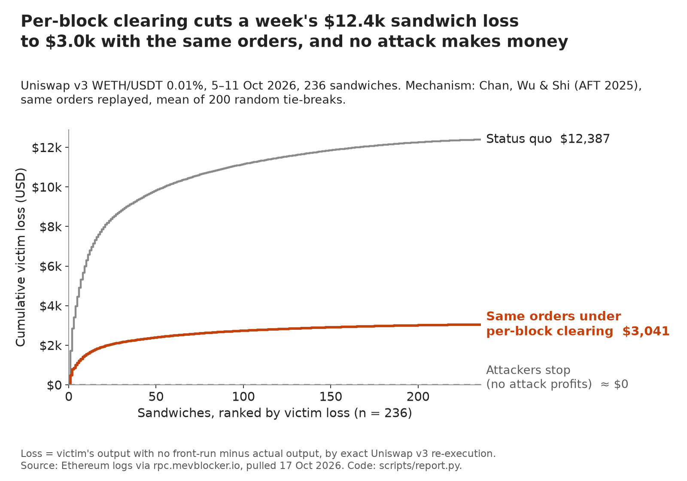

# MEV sandwich batch study: sandwich losses on Uniswap v3, replayed through per-block two-phase clearing

[](LICENSE)



This study measures sandwich attacks on the busiest WETH/USDT Uniswap v3 pool over one week of Ethereum mainnet data, then counts them with the same detector across three pools and four weeks. It estimates what the victims lost by exact replay of Uniswap v3's integer swap math. It then replays each block through the per-block, two-phase, arbitrage-resilient mechanism of Chan, Wu & Shi, "Mechanism Design for Automated Market Makers" (AFT 2025, [arXiv 2402.09357](https://arxiv.org/abs/2402.09357)), to estimate how much of that loss the mechanism would have prevented.

## Results

Uniswap v3 WETH/USDT 0.01% (`0xc7bbec68…ba1b0e9b`), 5–11 October 2026 UTC, blocks 26,122,440–26,172,657. Numbers are from `results/summary.json` unless another file is named.

| Finding | Value |
|---|---|
| Swaps in the week | 70,669 (69,028 transactions) |
| Sandwiches found | 236 (193 at the strict ±1% amount match) |
| Victims and their loss | 244 victims lost $12,387 against what they would have received with no front-run |
| Attacker gross and gas | $8,713 gross, of which $4,400 (50%) went to gas |
| Slippage taken | 98% of the victims' decodable slippage tolerance ($1,544 of $1,582, `results/tables.md`) |
| Attacker profit under the mechanism | No sandwich makes money in any run (best case $0.00) |
| Loss victims keep under the mechanism, same orders | 75% on average across 200 random tie-breaks (5th–95th percentile 68–84%; 52–99% across variants) |
| Loss victims keep if attackers stop | About 100% |
| Exact replay gate | 70,669 of 70,669 swaps reproduced bit-exactly, 4,041 of them across liquidity changes (`docs/methods.md`) |

Extension, 14 Sep to 11 Oct 2026 (`docs/multi-pool.md`, `results/multi-pool/`). The same detector, unchanged, ran on three Uniswap v3 pools for four consecutive weeks. The pools are the three with the most swaps on 7 Oct 2026. This part counts detections only: it has no loss or mechanism figures and no precision review of the new hits.

| Pool | Swaps in 4 weeks | Sandwiches by week (14 Sep, 21 Sep, 28 Sep, 5 Oct) | Total | Strict ±1% | Victims |
|---|---:|---|---:|---:|---:|
| USDC/WETH 0.01% | 613,626 | 218, 130, 103, 131 | 582 | 432 | 606 |
| WETH/USDT 0.01% | 307,983 | 324, 260, 193, 236 | 1,013 | 809 | 1,060 |
| USDC/WETH 0.05% | 214,976 | 0, 3, 4, 5 | 12 | 10 | 16 |

Both 0.01% pools are sandwiched every week and the 0.05% pool almost never, as in the 7 October scan. The 5 October row for WETH/USDT reproduces the main result (236 sandwiches, 244 victims). Per-week columns, attacker counts and the access limits are in `docs/multi-pool.md`.

Further results:

- **Memecoin extension (SIMD/WETH 0.01%, same week).** 13,052 swaps, 240 sandwiches, 242 victims and $1,330 lost. One automated buyer carried 95% of that loss. No attack pays under the mechanism, and victims keep 73% on average with the same orders (`results/simd-weth/summary.json`).
- **Detection cross-check.** A local re-implementation of Dune's spellbook rule confirms 99.6% (WETH/USDT) and 100% (SIMD/WETH) of the study's sandwich blocks. The 20 extra WETH/USDT blocks that Dune's rule flags all fail the study's 90–110% amount check (`results/dune-rule-replication.md`).
- **Precision review.** 30 of 30 randomly sampled hits have sandwich structure: 25 textbook sandwiches, 3 that lost the attacker money and 2 whose front-run also routes through other pools (`results/precision-review.md`).

## How it works

1. `scripts/ingest.py` pulls the week's Swap, Mint and Burn logs, transactions and the pool's starting state over JSON-RPC (`mev/rpc.py`) and saves them as Parquet.
2. `scripts/replay.py` checks that `mev/v3.py`, a Python port of Uniswap v3's integer swap math, reproduces every swap exactly. The gate requires 100% of swaps to match.
3. `scripts/analyze.py` finds sandwiches with `mev/detect.py`, computes counterfactual victim loss, decodes victim limits with `mev/calldata.py`, and re-clears each block under the paper's two-phase rules in `mev/mechanism.py`.
4. `scripts/inspect_hits.py` collects precision evidence, and `scripts/report.py` writes the tables and the figure.
5. `scripts/dune_rule.py` and `scripts/compare_dune.py` run the Dune spellbook rule on the same logs and compare it with the detector.

6. `scripts/multi_scan.py` runs `mev/detect.py` on several pools and weeks from Swap logs and transaction senders only, and `scripts/spot_check.py` draws the blind Etherscan sample (`results/spot-check/`).

`scripts/run_all.sh` runs the whole pipeline for both pools. It does not run the multi-pool extension; `docs/multi-pool.md` gives those commands.

## Run it

Prerequisites: Python 3.13 (the version tested) and [uv](https://docs.astral.sh/uv/). The pipeline uses the standard library plus `pyarrow` and `matplotlib`; `requirements.txt` pins the versions the tests last ran with, including `hypothesis` for the property-based tests.

Install and run the tests:

```bash
uv venv .venv
uv pip install --python .venv/bin/python -r requirements.txt
.venv/bin/python -m pytest -q
```

`pytest.ini` points pytest at `tests/` and the repo root, so plain `.venv/bin/pytest` works from the root as well. The suite has 40 tests: 21 hand-written ones and 19 property-based ones (`tests/test_v3_properties.py`, `tests/test_mechanism_properties.py`). The hand-written tests cover the v3 math, calldata decoding, the detector, the mechanism's rules and that the multi-pool block filter never changes detection. The property tests run Hypothesis over the whole tick range, random `mul_div` inputs, random swap steps and random pools with random order sets, and check the mechanism's no-profit (Theorem 3.1), limit and token-conservation rules.

CI runs `python -m pytest -q --hypothesis-profile=ci --hypothesis-seed=0` (500 examples per property, fixed seed, defined in `tests/conftest.py`). Plain `pytest` uses the `dev` profile (200 random examples). Observed on 2026-10-29 with the pinned requirements on Python 3.13: `36 passed, 4 xfailed in 7.57s` with the CI flags. Four tests are marked `xfail(strict=True)` because Hypothesis found counterexamples in `mev/mechanism.py` (three distinct causes); the reasons are in the test files and the pull request that added them. Fixing a defect turns its test into a strict-xfail failure until the marker is removed.

Reproduce every result:

```bash
scripts/run_all.sh
```

- This needs network access to a free archive RPC (`rpc.mevblocker.io`, with `eth.drpc.org` as fallback). No API key is needed.
- It takes about an hour, mostly to download transactions, and it rewrites `results/`.
- Its last step, `textbook/build.py`, needs the separate `rahil-design` bundle. Set `RAHIL_DESIGN` to its folder, or skip that step.

## Repository layout

- `mev/`: the library. Exact v3 swap math, the detector, calldata decoding, the mechanism, RPC access and pool constants.
- `scripts/`: the pipeline steps, the Dune-rule cross-check and the pool scans.
- `tests/`: pytest and Hypothesis tests for the v3 math, calldata decoding, the detector and the mechanism.
- `results/`: CSVs, `summary.json`, tables, the figure and its brief, and precision evidence. `results/simd-weth/` holds the memecoin extension, `results/multi-pool/` the three-pool, four-week detections and `results/spot-check/` the blind sample. `scripts/card.py` redraws the two "get back" cards (`results/mev-get-back-landscape.png`, `-square.png`) from `victims.csv`.
- `docs/`: the methods note, research notes, plan and pool selection.
- `textbook/`: a self-contained study guide (`index.html`) built by `build.py` from the results and the tested code.

`data/` and `references/` are local only and are not tracked in git.

## Documentation

- [`docs/methods.md`](docs/methods.md): the methods note. Read it first. It covers data, exact replay, detection, loss measures, the mechanism counterfactual, the memecoin extension and the limits.
- [`docs/research.md`](docs/research.md): the paper, the detection literature, the loss definitions and the data sources tested, with citations.
- [`docs/multi-pool.md`](docs/multi-pool.md): the three-pool, four-week extension: pool rule, data-access limits, results and caveats.
- [`docs/pool-selection.md`](docs/pool-selection.md): how the pool and week were chosen, and the 2026-10-18 correction about the missed USDC/WETH 0.01% pool.
- [`docs/plan.md`](docs/plan.md): the study plan, its acceptance criteria and its status.
- [`docs/dune/sandwiches.sql`](docs/dune/sandwiches.sql): a query to run on Dune itself as a further cross-check. It has not been run.

## Sources

- **On-chain data.** Ethereum mainnet logs, transactions, receipts and archive state from the public JSON-RPC endpoint `rpc.mevblocker.io`, pulled 17–18 October 2026. `eth.drpc.org` returned the same 70,669 swap logs.
- **Date range.** 5–11 October 2026 UTC, blocks 26,122,440–26,172,657. The block range is fixed in `mev/pool.py`. A rerun of the ingest gave byte-identical Parquet files (`docs/plan.md`).
- **Extension data.** Swap logs and transaction senders for three pools over 14 Sep–11 Oct 2026, pulled from `rpc.mevblocker.io` on 25 October 2026 (`docs/multi-pool.md`). Raw responses are not in git.
- **Mechanism.** T-H. Hubert Chan, Ke Wu and Elaine Shi, "Mechanism Design for Automated Market Makers", AFT 2025, [arXiv 2402.09357](https://arxiv.org/abs/2402.09357) v3.
- **Dune rule.** The public spellbook macros `dex_sandwiches.sql` and `dex_sandwiched.sql`, read on 2026-10-18 and re-implemented in `scripts/dune_rule.py`. No Dune account or Dune data was used.
- The license covers this project's code. It does not cover third-party data or papers.

## Scope and limits

- This is independent research. It is not affiliated with the paper's authors, Uniswap, Dune or any MEV searcher.
- The loss and mechanism results cover one pool and one week. The extension adds detection counts for two more pools and three more weeks. Four weeks are one sample, not a yearly rate.
- The extension's pools were picked by swap count on a single day (7 Oct 2026) and are Uniswap v3 only. The extension has no loss figures, and its new hits have had no precision review.
- The study pool is the busiest WETH/USDT pool, not the busiest pool. A later scan found that v3 USDC/WETH 0.01% has about 2.4 times the swaps (`docs/pool-selection.md`).
- The counterfactual replays the observed orders. It cannot say how bots, builders and traders would respond to the mechanism.
- The detector sees only same-block, single-pool sandwiches.
- Attacker payments to builders by internal ETH transfer are not counted, so attacker profit net of gas is an upper bound.
- The AI agent that built the pipeline did the precision review from receipts and read Etherscan pages for 5 hits. A human Etherscan spot-check is still pending: `results/spot-check/sample.md` holds 10 random detections with their labels hidden for that check.

## License

MIT. See [`LICENSE`](LICENSE).

Part of [Rahil Bhavan's projects](https://github.com/RahilBhavan).
